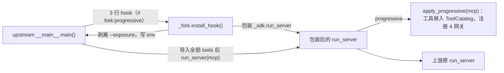

# Fork 说明（marble810/fxhoudinimcp）

本 fork 在上游 [healkeiser/fxhoudinimcp](https://github.com/healkeiser/fxhoudinimcp) 之上只加了一个功能：**渐进式披露（progressive disclosure）模式**。目标是：上游怎么改都能被低成本 LLM 自动合并。

## 使用

```bash
fxhoudinimcp --exposure progressive        # CLI 参数
FXHOUDINIMCP_EXPOSURE=progressive fxhoudinimcp   # 或环境变量（MCP 客户端配置里设 env）
```

默认 `full`，此时行为与上游**逐字节一致**。`progressive` 时只暴露 4 个网关工具：

| 工具 | 作用 |
|---|---|
| `houdini_discover(query?, category?, limit?)` | 列分类 / 关键词搜工具（不加载 schema） |
| `houdini_schema(tool_name \| tool_names)` | 取完整 docstring + 参数 JSON schema |
| `houdini_call(tool_name, arguments?)` | 执行任一工具；校验失败时自动附 docstring + schema |
| `houdini_batch(calls, stop_on_error?)` | 一次往返顺序执行多个调用 |

Server instructions = 网关前言（[`_fork/preamble.md`](../python/fxhoudinimcp/_fork/preamble.md)，工具数/分类自动计算）+ **上游 instructions 原文**，因此上游规则永不漂移。

## 架构：零侵入



- 上游文件中**唯一**的改动：`python/fxhoudinimcp/__main__.py` 的 `main()` 开头插入 3 行带 `# fork:progressive` 标记的 hook（由 `sync.py` 自动维护）。`install_hook` 带兜底：若 fork 代码因上游变化无法导入，`full` 模式照常启动上游，只有显式请求 `progressive` 才以退出码 2 报错——fork 坏了也不会拖垮上游 CLI。
- `server.py` / `_sdk.py` / `config.py` 与上游完全一致。网关复用上游注册好的**同一个 SDK Tool 对象**（已带 compact JSON 与严格参数校验），不复制任何上游逻辑。
- 所有对上游 API 和 MCP SDK 私有属性的依赖集中在 [`_fork/upstream_api.py`](../python/fxhoudinimcp/_fork/upstream_api.py)：上游/SDK 改名时只坏这一个文件。
- 测试 [`tests/test_fork_progressive.py`](../tests/test_fork_progressive.py) 不硬编码任何具体上游工具名，全部从上游当前注册的工具动态推导。

| 路径 | 归属 |
|---|---|
| `python/fxhoudinimcp/_fork/**` | fork |
| `tests/test_fork_*.py` | fork |
| `.fork/**` | fork（同步工具与 agent 指令） |
| `python/fxhoudinimcp/__main__.py` | 上游 + hook |
| 其他所有文件 | 上游，**禁止修改** |

## 上游同步

```bash
.venv\Scripts\python.exe .fork/sync.py auto --push
```

`auto` 流程：fetch → 建 `fork-sync/<sha>` 分支 → merge → 按归属表**确定性**解决冲突（上游文件取上游、fork 文件取 ours、hook 自动重插）→ 若 `pyproject.toml` 变化则重装依赖 → `verify`（边界检查 + ruff + 全量 pytest，并在上游基线 worktree 上跑一遍以扣除上游自身就失败的测试）→ fast-forward main →（可选）push。

其它子命令：`status` / `merge` / `check` / `verify` / `restore-hook` / `restore-upstream PATH` / `finish`，见 `sync.py --help`。

### 交给低成本 LLM 的 Loop

给 agent 的指令就是 [`.fork/AGENT.md`](AGENT.md)。例如定时任务的 prompt：

> Read `.fork/AGENT.md` in the repository and follow it exactly. Report using its template.

## 以后要加新的 fork 功能

1. 代码放 `python/fxhoudinimcp/_fork/`，测试放 `tests/test_fork_*.py`。
2. 需要上游的东西只经 `_fork/upstream_api.py` 引入。
3. 若确实需要新的 hook 点，修改 `.fork/sync.py` 顶部的边界常量并同步更新 `AGENT.md` 的归属表——尽量别这么做。
